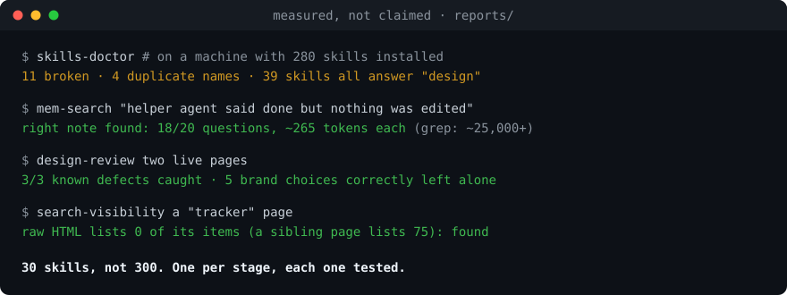

# Second Nature

*Make your way of working second nature to any AI agent: skills, memory, rules.*

[](https://github.com/anki1kr/second-nature/actions/workflows/check.yml)  

### 30 skills, not 300

**One tested agent skill for every stage of building a product, from "is this idea any good?" to launch day.**
Plain `SKILL.md` files, so any agent that reads them can use it: Claude Code, Codex, Cursor, Gemini CLI, opencode.
(Install checked with the `skills` CLI and loading checked in opencode; tell me if your agent misbehaves.)

[Hinglish me padho](README.hi.md)

<p align="center"></p>

## Why this exists

I had 280 skills installed. Then I ran a health check on them:

- **11 could not run at all** on my machine (missing dependencies, no requirements file).
- **4 names were each used by two skills**, so which one loaded was luck.
- **39 different skills answered the word "design".** The agent had to choose between them on every request, and it
  reads every skill's description to do that.

More skills made my agent slower to choose and more often wrong. So I did the opposite: I searched GitHub for the
best skill at each stage of building something, kept **one per stage**, ran each on a real project, and wrote my own
only where the existing ones overlapped or left a gap. This is what survived.

## Why it is better than installing a big pack

| | A big skill pack | Second Nature |
|---|---|---|
| How many skills the agent reads before every answer | hundreds, many overlapping (39 answered "design" on my machine) | about 30, one per stage, so the right one is obvious |
| Proof each skill works | usually none | [`reports/`](reports): checks that could have failed, with the misses written down |
| Does the pack check itself | no | [`skills-doctor`](skills/skills-doctor) finds broken, duplicate and badly formatted skills. It caught 2 of this pack's own skills being silently skipped by a strict installer; fixed before launch |
| Memory between sessions | none, or a separate tool with embeddings or a server | built in: about 400 tokens at start, local full-text search for the rest, no API |
| Lock-in | often one agent or one vendor | plain files, MIT; linked skills install from their authors' own repos, unchanged |
| Honest limits | rare | a "What is not proven" section below |

The point is not fewer features. It is fewer wrong turns: an agent that has one good skill per job, remembers your rules,
and checks a helper's work before calling it done.

## Install (30 seconds)

**Any agent** (needs Node):

```bash
npx skills@latest add anki1kr/second-nature
```

**No Node?** Clone and run the installer:

```bash
git clone https://github.com/anki1kr/second-nature && cd second-nature
bash install.sh --recommended        # Windows PowerShell: .\install.ps1 -Recommended
```

**Claude Code plugin:**

```bash
claude plugin marketplace add anki1kr/second-nature
claude plugin install second-nature@second-nature
```

`--recommended` also installs the 21 linked skills from their authors' own repositories. Add `--memory` to set up the
memory vault. Then ask your agent: *"which skills do I have for validating an idea?"*

## The 30, by stage

**Here** = written for this pack, lives in this repo. **Linked** = someone else's skill, the best I found for that
stage, installed from their repo unchanged. Licenses and reasons are in [CREDITS.md](CREDITS.md).

| Stage | Skill | |
|---|---|---|
| Is the idea worth building? | [`idea-truth`](skills/idea-truth) · [`decide`](skills/decide) | Here |
| Talk to real users | `customer-research` | Linked: coreyhaines31/marketingskills |
| Competitors and market size | `competitor-profiling` | Linked: coreyhaines31/marketingskills |
| Pricing | `pricing` | Linked: coreyhaines31/marketingskills |
| Spec | `spec-driven-development` | Linked: addyosmani/agent-skills |
| Design a new UI | `impeccable` | Linked: pbakaus/impeccable |
| Review an existing UI | [`design-review`](skills/design-review) | Here |
| Motion graphics and video | `hyperframes` | Linked: heygen-com/hyperframes. Remotion (React) also works, but its official skills repo has no license file and Remotion needs a paid license for some companies: check before using it at work |
| Frontend | `frontend-ui-engineering` | Linked: addyosmani/agent-skills |
| API and data model | `api-and-interface-design` | Linked: addyosmani/agent-skills |
| Tests and hard bugs | `tdd` · `diagnosing-bugs` | Linked: mattpocock/skills |
| Security | `security-audit` | Linked: cloudflare/security-audit-skill |
| CI and deploy | `ci-cd-and-automation` | Linked: addyosmani/agent-skills |
| Landing page | `copywriting` | Linked: coreyhaines31/marketingskills |
| Google and AI-answer visibility | [`search-visibility`](skills/search-visibility) | Here |
| Content, analytics, launch | `social` · `analytics` · `launch` | Linked: coreyhaines31/marketingskills |
| Pitch | `investor-materials` | Linked: affaan-m/ECC |
| Privacy policy and terms (EU GDPR, UK GDPR + PECR, US California CCPA/CPRA, India DPDP) | [`launch-legal`](skills/launch-legal) | Here |
| Stress-test the plan | `pre-mortem` · `inversion` | Linked: phuryn/pm-skills, danium/lateral-thinking |
| Hackathons | [`hackathon-agent`](skills/hackathon-agent) | Here |
| Run helper agents, check their work and their quota left | [`orchestrate`](skills/orchestrate) | Here |
| Remember across sessions | [`update-mem`](skills/update-mem) + [memory vault](docs/memory-system.md) | Here |
| Keep the pack healthy | [`skills-doctor`](skills/skills-doctor) | Here |
| Fewer tokens, less code | `caveman` · `ponytail` | Linked: JuliusBrussee/caveman, DietrichGebert/ponytail |

## What was actually tested

Every claim below has a report in [`reports/`](reports) or a script you can run. Nothing here is a benchmark of a
model; these are checks that the skill does its job.

| Skill | The test | Result |
|---|---|---|
| `design-review` | Run on two live pages with three defects already confirmed in the source code | Found 3 of 3, plus 7 more; kept 5 deliberate brand choices out of the findings. [Report](reports/design-review-test.md) |
| `search-visibility` | A page titled "tracker" whose raw HTML lists none of its items | First draft of the skill missed it. The check was added, then it found 0 item links against 75 on a sibling page. [Report](reports/search-visibility-test.md) |
| Memory search | 20 questions with a known answer file, half asked in the note's own words, half paraphrased | 9 of 20 before, **18 of 20** after an AND-then-OR fallback, about 265 tokens per question. Plain grep found all 20 at 25,000 to 200,000 tokens per question. |
| `launch-legal` | A made-up student web app with email sign-in, analytics cookies and third-party payments | Every checklist item cites its section of the DPDP Act 2023 or its GDPR article. [Report](reports/launch-legal-test.md) |
| `hackathon-agent` | `python skills/hackathon-agent/scripts/hack.py --self-check` and 25 unit tests | Pass. Standard library only. |
| `skills-doctor` | Run on this pack, and on the 280-skill install described above | This pack: 0 broken, 0 name collisions. |
| Install from the registry | `npx skills add` into an empty project, then ask opencode to load a skill | First run: 8 of 10 installed (2 descriptions broke strict YAML). After the fix and a new `skills-doctor` check: 10 of 10, and opencode loaded the skill from the project folder. |
| Memory vault | Fresh empty vault: setup, boot, budget, index, search; then setup a second time | All exit 0; the second setup refuses to overwrite. [Report](reports/memory-test.md) |

**What is not proven.** I have not measured that these skills make a model "smarter". The token and quality numbers
for `caveman` and `ponytail` are their authors' own benchmarks, linked from their repos. The linked skills were chosen
by reading them and comparing; not all 21 were run end to end. `launch-legal` is not legal advice.

**Safe to install.** No telemetry. Every skill is plain text you can read in two minutes. The only script that
calls the internet is `orchestrate/scripts/limits.py`, and only the providers whose keys you give it. Read a skill before you install
it: skills run with your agent's permissions.

## Memory that costs almost nothing

Most memory tools load a lot into every session. This one loads a small boot pack (a fresh vault: about 400 tokens)
and finds the rest on demand with a local full-text search: no embeddings, no API, no server. A lesson is stored in
the cheapest place that can hold it: a guard in the code, else a test, else a hook, else one line of text.
[How it works and how to set it up](docs/memory-system.md).

## For agents

[`AGENTS.md`](AGENTS.md) is the routing table: which skill to open for which request, and the eight working rules
the pack assumes (say what you assume, do the simplest thing, a helper's "done" is not evidence, never invent a
number).

## Contributing

One rule: a skill is added only if it beats what is already here on a real test, and it replaces that skill instead
of sitting next to it. The count stays near 30. Open an issue with the test you ran.

Every pull request is checked by CI (strict YAML, skills-doctor, every test) and reviewed by CodeRabbit with this repo's own rules (`.coderabbit.yaml`).

## Credits and license

The built-in skills, scripts and docs are MIT. The linked skills belong to their authors and keep their own
licenses; this repository does not copy them. Full list with licenses: [CREDITS.md](CREDITS.md).

Built by [anki1kr](https://github.com/anki1kr), a student, working with a lead agent and a team of free helper
agents. The helpers' reports were checked by hand; two of them were wrong, which is why `orchestrate` exists.
